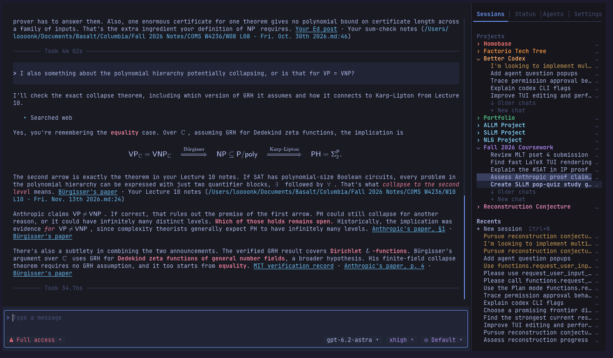
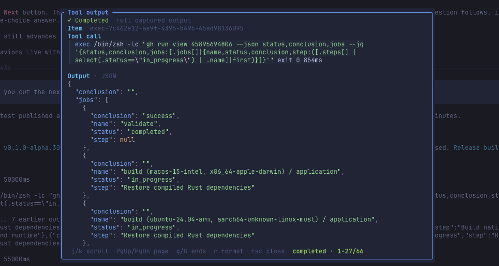

<div align="center">

<picture>
  <source media="(prefers-color-scheme: dark)" srcset=".github/assets/better-codex-logo-dark-mode.png">
  
</picture>

---

**A full-screen terminal workspace for Codex.**

Run agents, inspect tools, review edits, and manage every coding session without
leaving your terminal.

[Install](#install) · [Features](#features) ·
[Documentation](#documentation) · [Contribute](CONTRIBUTING.md)

</div>

<table>
  <tr>
    <td width="50%">
      <a href=".github/assets/main-tui.png"></a>
    </td>
    <td width="50%">
      <a href=".github/assets/latex-conversation.png"></a>
    </td>
  </tr>
</table>

Better Codex is a terminal app built on the Codex Rust backend, offering functionality beyond that of the standard Codex CLI.

## Install

Install the latest release on macOS or Linux and then launch it from any project:

```sh
curl -fsSL https://raw.githubusercontent.com/looooonk/better-codex/main/scripts/install.sh | sh
```

Better Codex uses the login and saved chats already in your Codex home. Once Better Codex is open, press `Ctrl+D` to toggle the dashboard.
All chats are compatible across Better Codex, the ChatGPT app, and the Codex CLI.
If you are new to Codex, choose ChatGPT sign-in, an OpenAI API key, or Amazon Bedrock during setup.

### System requirements

| Platform | Supported releases                                      | Architectures           |
| -------- | ------------------------------------------------------- | ----------------------- |
| macOS    | macOS 12 and newer                                      | Apple Silicon and Intel |
| Linux    | Ubuntu 20.04+, Debian 10+, and compatible distributions | ARM64 and x86_64        |

Git is optional but highly recommended for the built-in repository and review
features. Realtime voice additionally requires macOS 14+ or a Linux distribution
with glibc 2.28+ and a working audio device. Native Windows and WSL are not
currently supported.

<details>
<summary><strong>Install a specific version</strong></summary>

```sh
curl -fsSL https://raw.githubusercontent.com/looooonk/better-codex/main/scripts/install.sh \
  | sh -s -- --version 0.1.0-alpha.33
```

Browse every published build on the
[Releases page](https://github.com/looooonk/better-codex/releases).

</details>

<details>
<summary><strong>Build from source</strong></summary>

Install Rust through [rustup](https://rustup.rs/), plus Git, CMake, a C/C++
compiler, and `pkg-config`. Linux builds also require `bubblewrap`.

```sh
git clone https://github.com/looooonk/better-codex.git
cd better-codex/codex-rs
cargo install --locked just
just build --release
install_dir="$HOME/.local/share/better-codex/source/bin"
mkdir -p "$install_dir" "$HOME/.local/bin"
install -m 755 target/release/codex "$install_dir/better-codex"
install -m 755 target/release/codex-code-mode-host "$install_dir/"
install -m 755 target/release/codex-exec-server "$install_dir/"
ln -sfn "$install_dir/better-codex" "$HOME/.local/bin/better-codex"
```

See the [complete build guide](docs/install.md) for development tools, test commands, and logging.

</details>

## Features

Better Codex comes bundled with a plethora of features and aims to be a strict superset of the Codex CLI application.

|                            |                                                                                                                 |
| -------------------------- | --------------------------------------------------------------------------------------------------------------- |
| **Session-first workflow** | Create, search, resume, fork, rename, archive, and delete sessions from one dashboard.                          |
| **Live execution**         | Follow streaming responses and tool output while the agent works, with long results available in focused views. |
| **Built-in review**        | Inspect the complete edit set in a navigable, side-by-side diff before accepting the result.                    |
| **Visible agent state**    | Keep the plan, running tools, workspace changes, token usage, model, and reasoning effort in view.              |
| **Practical controls**     | Change models, permissions, appearance, authentication, and service tier without leaving the TUI.               |
| **Realtime voice**        | Talk with an agent through the isolated native voice helper; control the microphone and playback from the workspace. |
| **Extensible backend**     | Use MCP servers, plugins, skills, goals, and connected app-server or exec-server deployments.                   |
| **Session management** | Manage multiple Codex sessions, including projects and ChatGPT app sessions. |
| **LaTeX rendering** | View rendered LaTeX math in supported terminals. |
| **TPS estimation** | View live estimates of Codex’s output in tokens per second throughout a turn. |

<table>
  <tr>
    <td width="50%">
      <a href=".github/assets/tool-result.png"></a>
    </td>
    <td width="50%">
      <a href=".github/assets/file-diff.png"></a>
    </td>
  </tr>
  <tr>
    <td><strong>Stay on top of tools.</strong> Open a focused result viewer for commands and other agent activity without losing the surrounding conversation.</td>
    <td><strong>Review the whole change.</strong> Move between changed files and inspect additions and removals in a full-screen diff.</td>
  </tr>
</table>


## Updates

Managed installs check for new releases on startup and offer to update in place.
You can also update directly from the command line:

```sh
better-codex update
```

Rerunning the installer works as well.

## Documentation

- [Documentation index](docs/README.md)
- [Getting started](docs/getting-started.md)
- [Installation and development setup](docs/install.md)
- [Configuration](docs/config.md)
- [Authentication](docs/authentication.md)
- [Sandboxing and approvals](docs/sandbox.md)
- [Skills](docs/skills.md)
- [Slash commands](docs/slash_commands.md)
- [Repository guide for contributors](docs/repository-guide.md)

## Community

Bug reports, feature ideas, documentation improvements, and focused pull
requests are welcome. If something is not working, check the
[existing issues](https://github.com/looooonk/better-codex/issues) and then
[open a report](https://github.com/looooonk/better-codex/issues/new/choose).
For larger changes, please start with an issue so the approach can be discussed
before implementation.

Read [CONTRIBUTING.md](CONTRIBUTING.md) for the development workflow and review
expectations.

## License

Licensed under [Apache-2.0](LICENSE). Better Codex retains the notices required
by the upstream project, and we thank the Codex team for providing the upstream backend.
