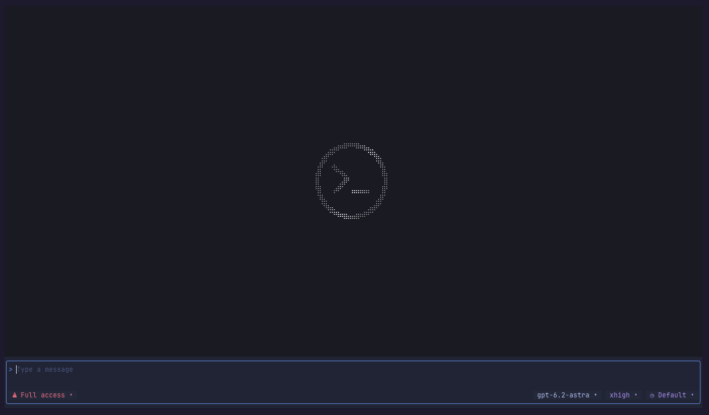
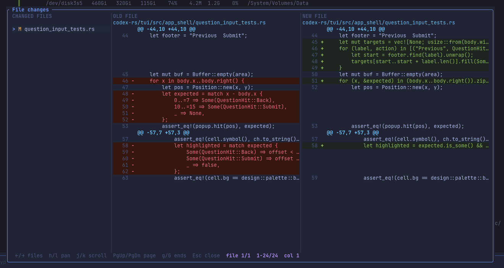

<div align="center">


<br>

---

**A full-screen terminal workspace for Codex.**

Run agents, inspect tools, review edits, and manage every coding session without
leaving your terminal.

[](https://github.com/looooonk/better-codex/releases)
[](#system-requirements)
[](LICENSE)
[](https://www.rust-lang.org/)

[Install](#install) · [Features](#everything-in-one-workspace) ·
[Documentation](#documentation) · [Contribute](CONTRIBUTING.md)

</div>



Better Codex is a terminal app built on the Codex Rust backend. It opens with
a full-width conversation. Press `Ctrl+D` to open the dashboard and resume
sessions, follow tool activity, or inspect file changes and project status.

## Install

Install the latest release on macOS or Linux, then launch it from any project:

```sh
curl -fsSL https://raw.githubusercontent.com/looooonk/better-codex/main/scripts/install.sh | sh
```

Better Codex uses the login and saved chats already in your Codex home. From
the same project, run `better-codex resume --last` to continue a chat from the
Codex App or CLI. You can reopen it in either client afterward. If you are new
to Codex, choose ChatGPT sign-in, an OpenAI API key, or Amazon Bedrock during
setup.

Better Codex inherits your existing settings. The first time you edit a
settings file in Better Codex, it saves a private copy alongside the original.
The standard App and CLI keep using their original file.

### System requirements

| Platform | Supported releases                                      | Architectures           |
| -------- | ------------------------------------------------------- | ----------------------- |
| macOS    | macOS 12 and newer                                      | Apple Silicon and Intel |
| Linux    | Ubuntu 20.04+, Debian 10+, and compatible distributions | ARM64 and x86_64        |

Git is optional but recommended for the built-in repository and review
features. Realtime voice additionally requires macOS 14+ or a Linux distribution
with glibc 2.28+ and a working audio device. Native Windows and WSL are not
currently supported.

<details>
<summary><strong>Install a specific version</strong></summary>

```sh
curl -fsSL https://raw.githubusercontent.com/looooonk/better-codex/main/scripts/install.sh \
  | sh -s -- --version 0.1.0-alpha.29
```

Browse every published build on the
[Releases page](https://github.com/looooonk/better-codex/releases).

</details>

<details>
<summary><strong>Build from source</strong></summary>

Install Rust through [rustup](https://rustup.rs/), plus Git, CMake, a C/C++
compiler, and `pkg-config`. Linux builds also require `bubblewrap`.

```sh
git clone https://github.com/looooonk/better-codex.git
cd better-codex/codex-rs
cargo install --locked just
just build --release
install_dir="$HOME/.local/share/better-codex/source/bin"
mkdir -p "$install_dir" "$HOME/.local/bin"
install -m 755 target/release/codex "$install_dir/better-codex"
install -m 755 target/release/codex-code-mode-host "$install_dir/"
install -m 755 target/release/codex-exec-server "$install_dir/"
ln -sfn "$install_dir/better-codex" "$HOME/.local/bin/better-codex"
```

The workspace pins its Rust toolchain, so `rustup` selects the expected version
automatically. `just build`, `just test`, and the other Cargo recipes fetch
checksum-pinned sandboxed V8 libraries and matching bindings from upstream Codex
releases. Realtime voice also needs the separately packaged native helper
and GStreamer runtime; building the Rust binaries above does not bundle them.
Source run commands such as `just codex --no-daemon` use the small development
profile by default; set `CODEX_CARGO_PROFILE` to select another profile.
See the [complete build guide](docs/install.md) for development
tools, test commands, and logging.

The backend is based on [Codex revision a54329e](https://github.com/openai/codex/commit/a54329e23522b787fbbe65a973e12348e53f7c72).
The bundled OpenAI, Bedrock, and Vertex AI model catalogs include the
[GPT-6.2 update](https://github.com/openai/codex/pull/62106).

</details>

## Everything in one workspace

Use `/model` to select GPT-6.2 Sol or Astra and see the reasoning levels and
service tiers your provider offers. Use `/provider use <id> [model]` followed
by `/new` to switch providers. Resumed chats keep their own provider catalog.

Click a source citation such as `src/main.rs:42:7` in a response to open the file
at that line and column. Press Escape to return to the conversation.

|                            |                                                                                                                 |
| -------------------------- | --------------------------------------------------------------------------------------------------------------- |
| **Session-first workflow** | Create, search, resume, fork, rename, archive, and delete sessions from one dashboard.                          |
| **Live execution**         | Follow streaming responses and tool output while the agent works, with long results available in focused views. |
| **Built-in review**        | Inspect the complete edit set in a navigable, side-by-side diff before accepting the result.                    |
| **Visible agent state**    | Keep the plan, running tools, workspace changes, token usage, model, and reasoning effort in view.              |
| **Practical controls**     | Change models, permissions, appearance, authentication, and service tier without leaving the TUI.               |
| **Realtime voice**        | Talk with an agent through the isolated native voice helper; control microphone and playback from the workspace. |
| **Extensible backend**     | Use MCP servers, plugins, skills, goals, and connected app-server or exec-server deployments.                   |

In the message pane, hold Shift and press Left or Right to select a character.
Add Option on macOS or Ctrl on Linux to select a word. Shift+Cmd+Left/Right
selects to the start or end of the draft on macOS. Ctrl+Shift+Home/End works
on either platform. Typing or pasting replaces the selection.

Consecutive tool calls share a row in the conversation. Click the row to show or hide
the original calls and their output. From the keyboard, press Alt+Up to select the
transcript, Tab to move to a tool group, and Space to toggle it.

**Experimental graphical math.** Open Settings → Experimental → Render LaTeX as images.
Better Codex checks for a compatible Kitty or Sixel terminal with pixel cell dimensions.
Assistant replies render inline math (`$…$`, `\(…\)`) and centered display math
(`$$…$$`, `\[…\]`) as soon as the closing delimiter arrives. The renderer includes its
own fonts. Equations that exceed its supported syntax or size use the text view.
The setting is local to Better Codex, and sessions retain their original Markdown.

During a turn, the activity line beneath the latest output shows the estimated token rate
from recent output packets. With the Better Codex backend, it holds the last estimate
during tool execution and while waiting for the next request to stream. For responses
without a measurable stream, the provider's output count supplies a rate at completion.
The turn divider shows total elapsed time and divides reported output tokens (including
reasoning) by the combined duration of the observed model requests, including request
latency. Turns without reported usage or reliable timing show elapsed time alone.
Use `better-codex --no-daemon` to run the bundled backend.

<table>
  <tr>
    <td width="50%">
      <a href=".github/assets/tool-result.png"></a>
    </td>
    <td width="50%">
      <a href=".github/assets/file-diff.png"></a>
    </td>
  </tr>
  <tr>
    <td><strong>Stay on top of tools.</strong> Open a focused result viewer for commands and other agent activity without losing the surrounding conversation.</td>
    <td><strong>Review the whole change.</strong> Move between changed files and inspect additions and removals in a full-screen diff.</td>
  </tr>
</table>


## Updates

Managed installs check for new releases on startup and offer to update in place.
You can also update directly from the command line:

```sh
better-codex update
```

Rerunning the installer works too. Either path activates the new verified
release while keeping the launcher path stable.

## Documentation

- [Documentation index](docs/README.md)
- [Getting started](docs/getting-started.md)
- [Installation and development setup](docs/install.md)
- [Configuration](docs/config.md)
- [Authentication](docs/authentication.md)
- [Sandboxing and approvals](docs/sandbox.md)
- [Skills](docs/skills.md)
- [Slash commands](docs/slash_commands.md)
- [Repository guide for contributors](docs/repository-guide.md)

## Community

Bug reports, feature ideas, documentation improvements, and focused pull
requests are welcome. If something is not working, check the
[existing issues](https://github.com/looooonk/better-codex/issues) and then
[open a report](https://github.com/looooonk/better-codex/issues/new/choose).
For larger changes, please start with an issue so the approach can be discussed
before implementation.

Read [CONTRIBUTING.md](CONTRIBUTING.md) for the development workflow and review
expectations.

## License

Licensed under [Apache-2.0](LICENSE). Better Codex retains the notices required
by the upstream project.
